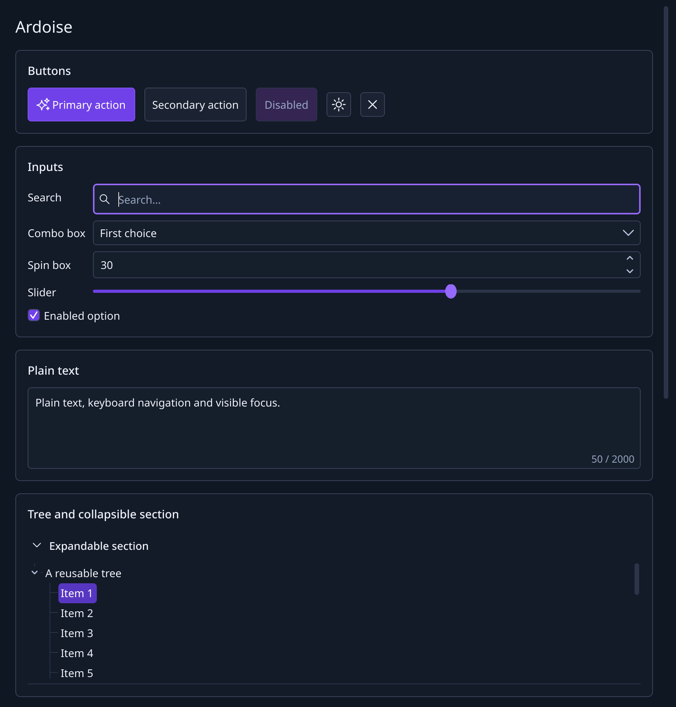
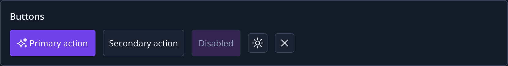
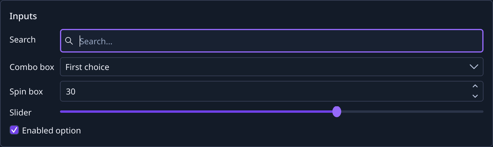
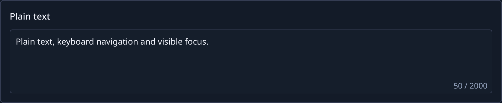
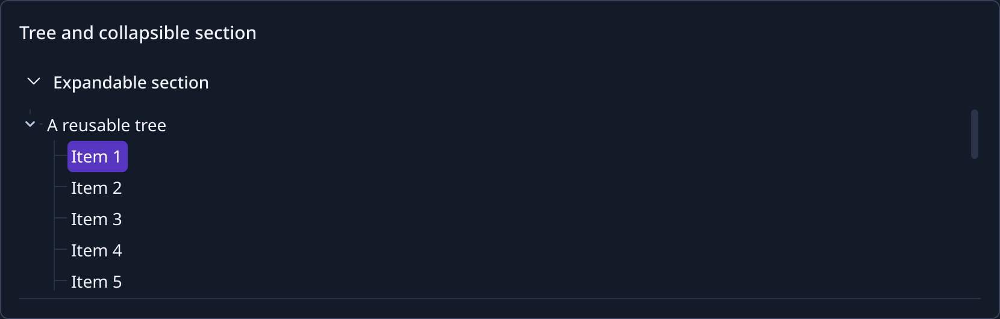
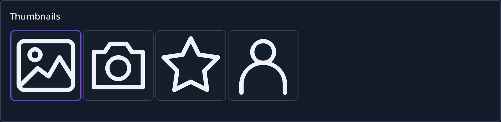
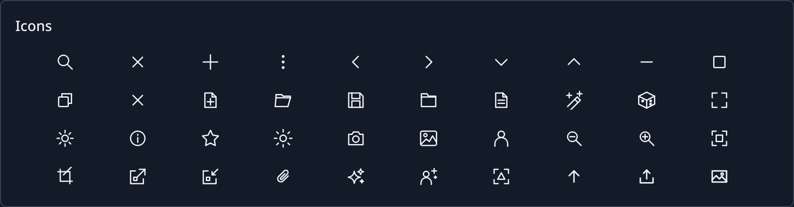
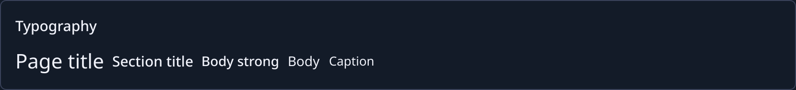
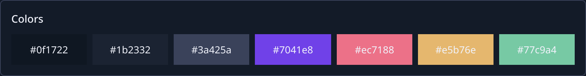

# Ardoise

[](https://github.com/jstmichel/ardoise/actions/workflows/ci.yml)
[](https://github.com/jstmichel/ardoise/releases/latest)
[](LICENSE)

*Français : [README.fr.md](README.fr.md)*

Ardoise is a dark theme and a set of reusable components for **Qt 6 Widgets** desktop
applications, written in C++20 and built with CMake. Linux, macOS and Windows share the
same painters, tokens and icons; windows and dialogs keep their native title bars.



- One call, `Ardoise::Theme::apply()`, styles every standard Qt control: no style sheets.
- Components add shared behavior on top of Qt classes and keep Qt's keyboard,
  accessibility and signals.
- 40 monochrome SVG icons, tinted by the theme and sharp at any scale.
- Design tokens (colors, spacing, radii, typography) available to your own widgets.
- English and French translations for the components' own text.
- A static library with a relocatable CMake package; no runtime dependency beyond
  Qt Widgets and Qt SVG.

## Status

Version 0.1.0, the first release. The API can change between minor versions before 1.0.
Linux is validated by automated offscreen tests; CI also builds and tests on macOS and
Windows. Release notes: [docs/release-notes/0.1.0.md](docs/release-notes/0.1.0.md).

## Quick start

Add Ardoise to a CMake project with `FetchContent`:

```cmake
include(FetchContent)
FetchContent_Declare(Ardoise
    GIT_REPOSITORY https://github.com/jstmichel/ardoise.git
    GIT_TAG v0.1.0)
FetchContent_MakeAvailable(Ardoise)

target_link_libraries(my-app PRIVATE Ardoise::Widgets)
```

Apply the theme right after creating the application, before creating widgets:

```cpp
#include <Ardoise/MainWindow.h>
#include <Ardoise/PrimaryButton.h>
#include <Ardoise/Theme.h>
#include <QApplication>

int main(int argc, char** argv)
{
    QApplication application(argc, argv);
    Ardoise::Theme::apply(application);

    Ardoise::MainWindow window;
    window.setWindowTitle(QStringLiteral("My application"));
    window.setContentWidget(new Ardoise::PrimaryButton(QStringLiteral("Start")));
    window.show();
    return application.exec();
}
```

`Ardoise::Widgets` brings the public headers, C++20 and Qt Widgets to your target.

## Use in another project

Ardoise needs CMake 3.21+, a C++20 compiler and Qt 6.2+ with Widgets, SVG and
LinguistTools. Pick one of three ways; all of them provide the `Ardoise::Widgets` target.

### FetchContent (recommended)

As in the quick start. Pin `GIT_TAG` to a release tag. To work on Ardoise and your
application together, point CMake at a local checkout instead of the download:

```sh
cmake -S . -B build -DFETCHCONTENT_SOURCE_DIR_ARDOISE=/path/to/ardoise
```

### Source checkout

With Ardoise as a Git submodule or a sibling folder:

```cmake
add_subdirectory(external/ardoise)
target_link_libraries(my-app PRIVATE Ardoise::Widgets)
```

Embedded this way, Ardoise builds only the library: no examples, tests or install rules.

### Installed package

Install Ardoise once, then find it like any CMake package:

```sh
cmake -S ardoise -B ardoise/build -G Ninja -DCMAKE_BUILD_TYPE=Release
cmake --build ardoise/build
cmake --install ardoise/build --prefix "$HOME/.local/ardoise"
```

```cmake
find_package(Ardoise 0.1 CONFIG REQUIRED)
target_link_libraries(my-app PRIVATE Ardoise::Widgets)
```

Configure your application with `-DCMAKE_PREFIX_PATH="$HOME/.local/ardoise"`. The prefix
can be moved; Qt must stay discoverable. Packages are compatible within the same minor
version.

Ardoise is a static library: it does not bundle Qt, and your application deploys Qt as
usual (`windeployqt`, `macdeployqt`, distribution packages).

## Components

Each image comes from the gallery (`examples/gallery`). Standard Qt controls need no
subclass: the theme styles them.

### Buttons



```cpp
auto* save = new Ardoise::PrimaryButton(
    Ardoise::IconProvider::icon(Ardoise::Icon::Save), tr("Save"));
auto* cancel = new QPushButton(tr("Cancel"));        // secondary action, themed

auto* settings = new Ardoise::IconButton(Ardoise::Icon::Settings, tr("Settings"));
auto* remove = new Ardoise::IconButton(Ardoise::Icon::Close, tr("Remove"));
remove->setTone(Ardoise::ButtonTone::Destructive);   // red on hover
```

`PrimaryButton` is the main action of a screen. `IconButton` is a compact, accessible
icon-only action: its label becomes the tooltip and the accessible name. Set the
`ardoiseFlat` property to `true` on toolbar buttons for a borderless look.

### Inputs



```cpp
auto* search = new Ardoise::SearchField;             // search icon and clear button
search->setPlaceholderText(tr("Search…"));
connect(search, &QLineEdit::textChanged, this, &MyView::filter);
```

`QLineEdit`, `QComboBox`, `QSpinBox`, `QDoubleSpinBox`, `QSlider` and `QCheckBox` are
styled by the theme with the same heights, borders and focus outline.

### Plain text



```cpp
auto* prompt = new Ardoise::PlainTextEdit;
prompt->setCounterVisible(true);
prompt->setReferenceLength(2000);                    // advisory: shows "50 / 2000"
prompt->setFixedHeight(prompt->heightForLines(3));
```

The counter is a hint and never truncates the text.

### Tree and collapsible section



```cpp
auto* tree = new Ardoise::TreeView;
tree->setModel(model);                               // any QAbstractItemModel

auto* section = new Ardoise::CollapsibleSection(tr("Layers"), tree);
connect(section, &Ardoise::CollapsibleSection::expandedChanged, this, &MyView::save);
```

`CollapsibleSection` has a full-width, keyboard-operable header, an optional accessory
widget (`setAccessoryWidget`) and a separator you can hide on the last section.

### Thumbnails



```cpp
auto* strip = new Ardoise::ThumbnailView;            // one horizontal row, 112 × 112
strip->setModel(images);                             // images in Qt::DecorationRole
```

`ThumbnailView` uses `ThumbnailDelegate`, which keeps the aspect ratio, rounds the
corners and draws the selection border.

### Icons



```cpp
QIcon icon = Ardoise::IconProvider::icon(Ardoise::Icon::Upload);
QIcon muted = Ardoise::IconProvider::icon(Ardoise::Icon::Info, Ardoise::IconTone::Muted);
```

Tones are `Default`, `Muted`, `Accent` and `Danger`. The full list is the `Ardoise::Icon`
enum in [IconProvider.h](include/Ardoise/IconProvider.h).

### Windows, dialogs and panels

```cpp
Ardoise::Dialog dialog(this);                        // native title bar, Escape rejects
dialog.setWindowTitle(tr("Export"));
dialog.setContentWidget(form);

auto* panel = new Ardoise::Panel;                    // solid surface with a border
panel->setCornerRadius(Ardoise::Theme::tokens().metrics.radiusLarge);
auto* layout = new QVBoxLayout(panel);
```

`MainWindow` and `Dialog` keep native decorations; put your menus in the content and
use `setWindowTitle` and `setWindowIcon`.

### Typography and colors





```cpp
Ardoise::Theme::applyTypography(title, Ardoise::TextRole::PageTitle);

const auto& tokens = Ardoise::Theme::tokens();
painter.setPen(tokens.colors.textMuted);
layout->setSpacing(tokens.metrics.spacing12);
```

Use the tokens in your own widgets instead of hard-coded values. The full visual contract
is in [docs/design-system.md](docs/design-system.md).

### Translations

`Theme::apply()` installs the English or French translation of the components' own
text, following the system language. Call `Theme::installTranslations(application,
locale)` to follow a language chosen in your application.

## Build and test

```sh
cmake -S . -B build -G Ninja
cmake --build build
ctest --test-dir build --output-on-failure
```

Tests run offscreen. Open the gallery with `./build/examples/gallery/ardoise-gallery`,
and take the screenshots of this page again with `scripts/screenshots.sh`.

See [CONTRIBUTING.md](CONTRIBUTING.md) for platform setup and build options, and
[docs/architecture.md](docs/architecture.md) for the library's boundaries.

## License

[MIT](LICENSE).
